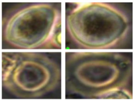
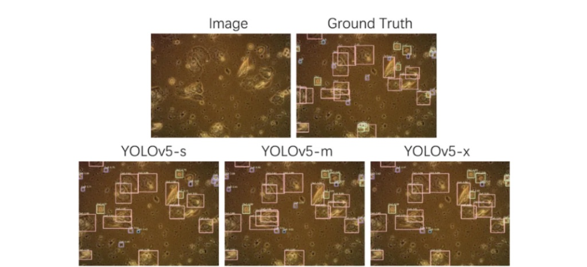
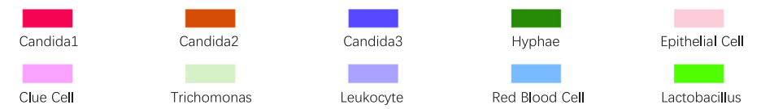
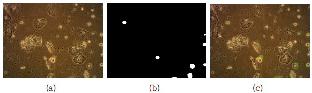
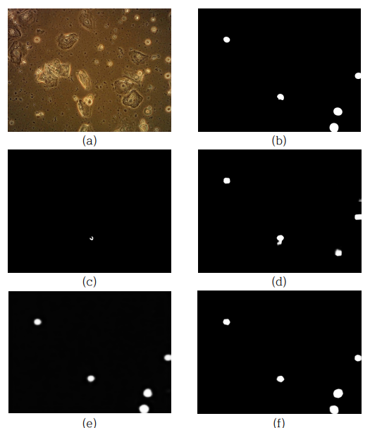

# VaDiCAD: Trichomonas vaginalis Detection in Microscopic Smears

<p align="center">
  
  
  
  
  
</p>

> **Official repository for the undergraduate thesis (June 2026)**  
> **Title**: *Trichomonas vaginalis Detection in Microscopic Smear Samples: A Performance Comparison of Deep Learning-Based Models*  
> **Author**: **Doyeon Lim** (HUFS Department of Biomedical Engineering)  

---

## 📌 Overview

*Trichomonas vaginalis* is a parasitic protozoan responsible for trichomoniasis, one of the most common sexually transmitted infections (STIs). In clinical microscopic smear examinations, identifying *T. vaginalis* poses significant challenges because its semi-transparent cytoplasm and ambiguous cell borders blend seamlessly into complex background noise, such as epithelial cells, white blood cells, and mucus.

This repository conducts a systematic benchmark comparing standard **Object Detection (YOLO series)** against **Camouflaged Object Detection (COD series)** models on identical microscopic smear datasets. In addition to quantitative evaluation, an interactive **Streamlit Result Viewer** is provided for fast qualitative verification.

<p align="center">
  
  <br>
  <em>Figure 1. Microscopic smear examples of Trichomonas vaginalis showing semi-transparent cytoplasm and indistinct boundaries that cause visual assimilation into the background.</em>
</p>

---

## ⚠️ Problem Formulation & Motivation

Previous large-scale benchmarks (e.g., MVDI25K) demonstrated that off-the-shelf YOLO detectors often suffer from high False Positive rates and missed detections (False Negatives) when dealing with camouflaged protozoa[cite: 39, 40]. 

<p align="center">
  <!-- 상단: 모델별 객체 탐지 결과 이미지 -->
  
  <br>
  <!-- 하단: 영문 클래스 범례 이미지 -->
  
  <br>
  <em>Figure 2. Object detection results from the MVDI25K benchmark across YOLOv5 scales. Genuine Trichomonas vaginalis targets (light green bounding boxes) are frequently missed (False Negatives) across all YOLOv5 variants due to visual camouflage into complex background debris[cite: 41].</em>
</p>

To address this morphological constraint, this study implements and evaluates COD models specifically engineered to segment hidden boundaries, comparing them directly against YOLO detectors under a standardized evaluation protocol[cite: 42, 43].

---

## 🔄 Mask-to-Bounding Box Conversion Protocol

Because COD models output pixel-level binary masks while YOLO outputs bounding boxes, a contour-based projection is required for fair comparison. Using OpenCV contour tracking, the minimum enclosing bounding boxes are reverse-computed from COD prediction masks and evaluated using standardized object detection metrics ($IoU \ge 0.5$).

<p align="center">
  
  <br>
  <em>Figure 3. Mask-to-bounding box projection pipeline: <strong>(a)</strong> Input microscopic smear image, <strong>(b)</strong> DGNet predicted binary segmentation mask, and <strong>(c)</strong> Reverse-calculated bounding box coordinates overlaid on the original image for unified evaluation.</em>
</p>

---

## 📊 Experimental Results

### 1. Unified Detection Comparison (Bounding Box Metric, $IoU \ge 0.5$)
All 7 models evaluated on the identical test set under the bounding box framework:

| Model | Paradigm | Precision | Recall | $F_1$-Score | $\text{AP}_{50}$ |
| :--- | :---: | :---: | :---: | :---: | :---: |
| **YOLOv8-n** | YOLO | **0.703** | 0.857 | **0.772** | **0.853** |
| YOLOv8-s | YOLO | 0.676 | 0.859 | 0.757 | 0.850 |
| **YOLOv5-s** | YOLO | 0.677 | **0.870** | 0.762 | 0.826 |
| BGNet | COD | 0.413 | 0.462 | 0.436 | 0.196 |
| DGNet | COD | 0.376 | 0.515 | 0.435 | 0.196 |
| SINet_V2 | COD | 0.374 | 0.503 | 0.429 | 0.198 |
| ZoomNet | COD | 0.086 | 0.079 | 0.083 | 0.007 |

### 2. COD Model Segmentation Benchmark (Pixel-Level)
Intrinsic segmentation metrics evaluate boundary fidelity, structural similarity ($S_m$), and absolute pixel error (MAE):

| Model | S-measure ($S_m \uparrow$) | F-measure ($F_\beta \uparrow$) | MAE ($\downarrow$) | Remark |
| :--- | :---: | :---: | :---: | :--- |
| **DGNet** | **0.751** | **0.654** | **0.038** | Superior boundary gradient & texture preservation |
| **BGNet** | 0.734 | 0.618 | 0.043 | Edge-guided boundary refinement |
| **SINet_V2** | 0.722 | 0.613 | 0.046 | Detects main targets but retains fine noise |
| **ZoomNet** | 0.695 | 0.570 | 0.052 | Mask fragmentation due to high background interference |

<p align="center">
  
  <br>
  <em>Figure 4. Visual comparison of COD segmentation masks: <strong>(a)</strong> Original input image, <strong>(b)</strong> Ground Truth (GT), <strong>(c)</strong> ZoomNet mask (severe fragmentation), <strong>(d)</strong> SINet_V2 mask (captures target but retains minor artifacts), <strong>(e)</strong> BGNet mask (sharp boundary definition), and <strong>(f)</strong> DGNet mask (highest fidelity with minimal noise).</em>
</p>

---

## 💡 Key Findings & Proposed Hybrid Pipeline

1. **Trade-offs in Single-Model Deployment**:
   * **YOLOv8-n** showed the best bounding box accuracy ($\text{AP}_{50}$ 0.853), proving ideal for rapid candidate region screening.
   * **DGNet** demonstrated unmatched pixel-level boundary extraction ($S_m$ 0.751, MAE 0.038), effectively separating semi-transparent membrane structures from debris.
2. **Analysis of COD Bounding Box Degradation**:
   * The low $\text{AP}_{50}$ (~0.19) for COD models under box metrics stems from conversion penalties: minute debris noise causes outer contour boxes to expand excessively, dropping IoU below 0.5.
3. **Proposed Serial Hybrid Pipeline**:
   * Combining YOLO for **fast global ROI screening** followed by DGNet for **localized high-precision boundary segmentation** offers the optimal design for clinical decision support.

---

## 🖥 Streamlit Result Viewer

A lightweight interactive demo viewer is provided to inspect test samples, compare model outputs side-by-side, and visualize mask-to-box transformations.

```bash
# 1. Clone repository
git clone [https://github.com/dylim-326/VaDiCAD.git](https://github.com/dylim-326/VaDiCAD.git)
cd VaDiCAD

# 2. Install dependencies
pip install -r requirements.txt

# 3. Launch viewer
streamlit run app.py
```

---

## 📂 Repository Structure

```bash
VaDiCAD/
├── assets/                  # Qualitative figures and thesis assets
│   ├── fig1_yolo_mvdi25k.png
│   ├── fig2_trichomonas_sample.png
│   ├── fig3_cod_comparison.png
│   └── fig4_mask_to_bbox.png
├── data/                    # Dataset split & preprocessing logic
├── models/
│   ├── yolo/                # YOLO configs and inference wrappers
│   └── cod/                 # ZoomNet, SINet_V2, BGNet, DGNet architectures
├── utils/
│   ├── mask2bbox.py         # Contour-to-bounding-box conversion
│   └── metrics.py           # Segmentation & detection evaluators
├── app.py                   # Streamlit qualitative comparison viewer
├── requirements.txt
└── README.md
```

---

## 📖 Citation

```bibtex
@thesis{lim2026trichomonas,
  title     = {현미경 도말 검체 내 트리코모나스 탐지: 딥러닝 기반 모델 성능 비교 (Trichomonas vaginalis Detection in Microscopic Smear Samples: A Performance Comparison of Deep Learning-Based Models)},
  author    = {Doyeon Lim},
  school    = {Hankuk University of Foreign Studies, Department of Biomedical Engineering},
  year      = {2026},
  note      = {Undergraduate Thesis, Advisor: Prof. Bo-Hyoung Kim}
}
```